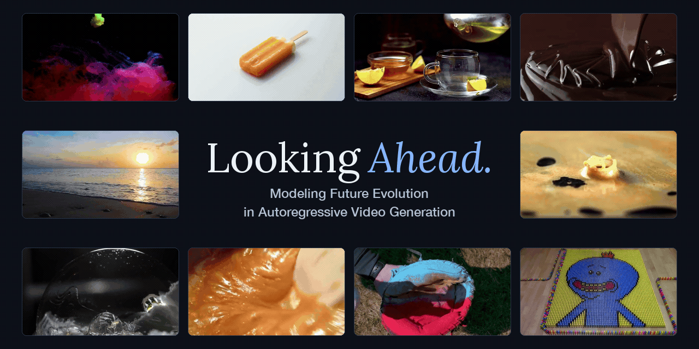

<h1 align="center">Looking Ahead: Modeling Future Evolution in Autoregressive Video Generation</h1>

<p align="center">
  <a href="https://ruopenggao.com/">Ruopeng Gao</a><sup>1</sup>,
  <a href="https://yukun-huang.github.io/">Yukun Huang</a><sup>2,†</sup>,
  <a href="https://scholar.google.com/citations?user=0CJPK3IAAAAJ&amp;hl=zh-CN">Jiarui Hu</a><sup>3</sup>,
  <a href="https://wangsssssss.github.io/">Shuai Wang</a><sup>1</sup>,
  <a href="https://wbhu.github.io/">Wenbo Hu</a><sup>2</sup>,
  <a href="https://scholar.google.com.hk/citations?user=4oXBp9UAAAAJ">Ying Shan</a><sup>2</sup>,
  <a href="https://wanglimin.github.io/">Limin Wang</a><sup>1,*</sup>
</p>

<p align="center">
  <sup>1</sup>Nanjing University &nbsp; <sup>2</sup>ARC Lab, Tencent IEG &nbsp; <sup>3</sup>Zhejiang University
</p>

<p align="center">
  <sup>†</sup>Project Lead &nbsp; <sup>*</sup>Corresponding Author
</p>

<p align="center">
   &nbsp;
  <a href="https://hellorpg.github.io/looking-ahead/"></a> &nbsp;
  
</p>

<p align="center">
  
</p>

## 🔍 Introduction

Understanding visual evolution is essential for autoregressive video generation and world modeling.
Yet temporal redundancy can encourage local temporal shortcuts during teacher-forcing training, weakening the incentive to learn underlying dynamics.
To address this challenge, we introduce ***Future Chunk Prediction (FCP)***, which trains autoregressive video models to look ahead through auxiliary branches that predict temporally distant video chunks from intermediate features of the current chunk.
Using ***only video-pixel supervision, FCP improves physical consistency in generated videos and learns more semantically structured representations***.

We provide training and inference code, along with weights for 1.3B and 5B autoregressive text-and-image-to-video (TI2V) models. Stay tuned for more model sizes and variants.

## 🔥 News

- **2026-10-21:** Our [project page](https://hellorpg.github.io/looking-ahead/) and code are now available! Visit the project page for more demos.

## 🚧 Upcoming

We are continuing to improve this project and explore new directions. Watch this repository to stay up to date with our progress. The documentation is also evolving: if you have any questions about using the project, please open an issue. Where helpful, we will incorporate clarifications into future documentation updates.

- Release model weights.
- Release demo datasets.
- Add conda + pip installation instructions.

## ⚙️ Setup

We tested this project on Linux with an NVIDIA H200 GPU, Python 3.12.3 and PyTorch 2.10.0+cu128 (CUDA 12.8); compatibility with other environments has not been tested.

You can set up the environment using any of the following methods.

### uv (recommended)

Install [uv](https://docs.astral.sh/uv/getting-started/installation/), then run the following commands from the repository root.

On Ubuntu / Debian, install FFmpeg if it is not already available:

```bash
sudo apt-get update
sudo apt-get install -y ffmpeg
```

Install the project environment with Python 3.12:

```bash
UV_CACHE_DIR=.uv-cache uv sync --python 3.12
# Activate the virtual environment
source .venv/bin/activate
```


### conda + pip

> 🚧 **TODO:** Installation instructions will be added here.


## 🤗 Model Downloads


### Upstream Model Weights

Download the upstream model corresponding to your selected model size. Each repository includes the base model weights, configuration, text encoder, tokenizer and VAE.


| Model           | Download                                                         |
| --------------- | ---------------------------------------------------------------- |
| Wan2.1-T2V-1.3B | [🤗 Hugging Face](https://huggingface.co/Wan-AI/Wan2.1-T2V-1.3B) |
| Wan2.2-TI2V-5B  | [🤗 Hugging Face](https://huggingface.co/Wan-AI/Wan2.2-TI2V-5B)  |


After activating your environment, download the model from the repository root using the [Hugging Face CLI](https://huggingface.co/docs/huggingface_hub/guides/cli):

```bash
# 1.3B
hf download Wan-AI/Wan2.1-T2V-1.3B \
  --local-dir weights/Wan-AI/Wan2.1-T2V-1.3B

# 5B
hf download Wan-AI/Wan2.2-TI2V-5B \
  --local-dir weights/Wan-AI/Wan2.2-TI2V-5B
```

These commands place the models in the default lookup directories under `./weights/Wan-AI` when running from the repository root. To use another location, set `WAN_ROOT` to the parent directory containing the model folders.

### Our Model Weights


| Model Size | Method        | Task | Final Weights |
| ---------- | ------------- | ---- | ------------- |
| 1.3B       | TF (baseline) | TI2V | 🚧 TODO       |
| 1.3B       | FCP (ours)    | TI2V | 🚧 TODO       |
| 5B         | TF (baseline) | TI2V | 🚧 TODO       |
| 5B         | FCP (ours)    | TI2V | 🚧 TODO       |


Save the downloaded weights under `weights/Looking-Ahead/`, using the corresponding configuration name as the subdirectory and `model_ema.pt` as the filename.

```text
weights/Looking-Ahead/
├── tf_wan21_t2v_1.3b/model_ema.pt
├── fcp_wan21_t2v_1.3b/model_ema.pt
├── tf_wan22_ti2v_5b/model_ema.pt
└── fcp_wan22_ti2v_5b/model_ema.pt
```


## 🎬 Inference


### Text-and-Video-to-Video Generation

Run this single-GPU example from the repository root. It uses the 5B FCP model
and the supplied milk-pouring video and prompt to generate a 5-second video,
including the input context:

```bash
python inference.py \
  --config fcp_wan22_ti2v_5b \
  --checkpoint_path weights/Looking-Ahead/fcp_wan22_ti2v_5b/model_ema.pt \
  --use_ema \
  --video_path examples/inference/v2v/milk_pouring.mp4 \
  --prompt_file examples/inference/v2v/milk_pouring.txt \
  --duration 5s --seed 42 --sink 3 \
  --output_path outputs/v2v/fcp_milk_pouring
```

By default, inference selects the longest valid tail segment of the input video
as the prefix. Use `--v2v_context_latents` to set the prefix length manually.
See the [inference documentation](docs/inference.md) for details.

### General Text-and-Image-to-Video Generation

Run the following single-GPU example from the repository root. It generates a 5-second video using the 1.3B FCP model, the provided sailboat image and its matching prompt file:

```bash
python inference.py \
  --config fcp_wan21_t2v_1.3b \
  --checkpoint_path weights/Looking-Ahead/fcp_wan21_t2v_1.3b/model_ema.pt \
  --use_ema \
  --image_path examples/inference/i2v/sailboat_lake.png \
  --prompt_file examples/inference/i2v/sailboat_lake.txt \
  --duration 5s --seed 42 \
  --output_path outputs/example_inference
```

Input images are automatically resized with their aspect ratio preserved and
center-cropped to match the model's resolution.
See the [inference documentation](docs/inference.md) for more usage details.

## 🏋️ Training


### Data Preparation

We provide a demo dataset to help you get started with training; custom datasets should follow the format below.

> 🚧 **TODO:** Demo dataset download link will be added here.

Place the downloaded demo datasets in the following directories under the repository root, preserving the `source_a/` and `source_b/` subdirectories:

- **1.3B:** `release_assets/dataset_demo/wan21_t2v_1.3b/`
- **5B:** `release_assets/dataset_demo/wan22_ti2v_5b/`

These paths are configured in `data_sources` in the corresponding YAML files under `configs/` (e.g., [fcp_wan21_t2v_1.3b.yaml](configs/fcp_wan21_t2v_1.3b.yaml) and [fcp_wan22_ti2v_5b.yaml](configs/fcp_wan22_ti2v_5b.yaml)); the TF configurations use the same dataset paths. For each source, `data_path` points to its `latent_shards/` directory, and `annotation_path` points to its `annotations.jsonl` file. If you store the datasets elsewhere, update these fields in your selected configuration.

### Training Examples

```bash
# Use all visible GPUs with W&B enabled and the default output directory
bash run.sh train fcp_wan21_t2v_1.3b

# Select GPUs
CUDA_VISIBLE_DEVICES=0,1,2,3 bash run.sh train fcp_wan21_t2v_1.3b

# Disable W&B
bash run.sh train fcp_wan21_t2v_1.3b --disable_wandb

# Specify the output directory
bash run.sh train fcp_wan21_t2v_1.3b --exp_dir outputs/my_experiment
```

To train another model or baseline, replace `fcp_wan21_t2v_1.3b` with `tf_wan21_t2v_1.3b`, `fcp_wan22_ti2v_5b`, or `tf_wan22_ti2v_5b`. Each name corresponds to a YAML file under `configs/`.
